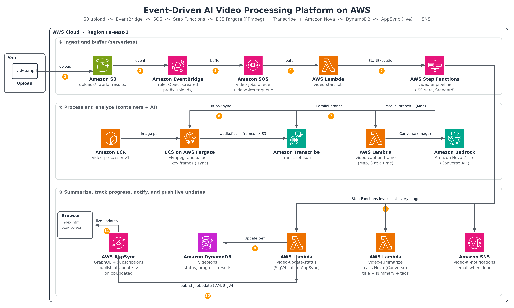

# AI Video Processing Platform on AWS

An event-driven pipeline that turns an uploaded video into a transcript, frame captions, a title, a summary and tags, and shows the progress live in a web page.

```
S3 upload -> EventBridge -> SQS -> Lambda -> Step Functions
                                              |-> ECS Fargate (FFmpeg: audio + key frames)
                                              |-> Parallel: Amazon Transcribe  |  Map -> Lambda -> Amazon Nova (captions)
                                              |-> Lambda -> Amazon Nova (title, summary, tags)
                                              |-> Lambda -> DynamoDB + AppSync (live progress) ; SNS email
```



The step-by-step console walkthrough (with screenshots) is in the blog post that goes with this repository. This README is the short version.

Each Lambda lives in its own folder as `lambda_function.py` and exposes `handler` (the console default file name with a shorter function name). Set the runtime handler to `lambda_function.handler`.

## What is in the repo

| Folder | Contents |
|---|---|
| `container/` | `Dockerfile` and `process.py`: FFmpeg audio and key frame extraction, runs on ECS Fargate |
| `lambdas/start_job/` | SQS-triggered Lambda (`lambda_function.py`, handler `handler`) that starts one Step Functions execution per uploaded video |
| `lambdas/update_status/` | Writes job progress to DynamoDB and publishes it to AppSync (SigV4) |
| `lambdas/caption_frame/` | Captions one key frame with Amazon Nova 2 Lite (Bedrock Converse API) |
| `lambdas/summarize/` | Creates title, summary and tags from the transcript and captions |
| `statemachine/pipeline.asl.json` | The Step Functions workflow (JSONata) |
| `appsync/` | GraphQL schema and the two JavaScript resolvers |
| `web/index.html` | Static page that follows job progress over a WebSocket subscription |
| `iam/`, `eventbridge/` | Least-privilege policies (including `iam/policy-step-functions-logging.json` for state-machine Error logging), trust policies, the EventBridge pattern and SQS policy |
| `scripts/render.py` | Fills the `__PLACEHOLDER__` tokens from `config.env` |
| `scripts/cleanup.sh` | Optional CLI cleanup of everything |
| `tests/` | Offline unit tests for the Lambdas |
| `sample/` | A 60 second public-domain NASA clip to test with |

## Quick start

Region: **us-east-1**. Create everything with the console as described in the blog, or follow this outline.

1. `cp config.env.example config.env` and fill in your account ID, a globally unique bucket name, subnet IDs and a security group.
2. `python3 scripts/render.py config.env` writes ready-to-paste policies and the state machine definition to `build/` (git-ignored).
3. Create, in this order: S3 bucket (EventBridge notifications ON) -> DynamoDB table `VideoJobs` (partition key `jobId`, String) -> SNS topic `video-ai-notifications` -> SQS `video-jobs-dlq` and `video-jobs-queue` -> AppSync API (schema, API key, IAM auth, resolvers) -> ECR repo `video-processor`, build and push `container/` -> ECS cluster `video-ai-cluster` and task definition `video-processor-task` -> IAM roles and the four Lambda functions -> state machine `video-ai-pipeline` -> start-job Lambda with the SQS trigger -> EventBridge rule `video-uploaded-rule`.
4. Put the AppSync URL and API key into `web/index.html` (do not commit them) and open it in a browser.
5. Upload `sample/stereo-overview-60s.mp4` to `s3://<your-bucket>/uploads/`.

Build and push the container (use `--platform linux/amd64` if you build on Apple silicon; the task definition uses X86_64):

```bash
source config.env
aws ecr get-login-password --region "$REGION" | docker login --username AWS --password-stdin "$ACCOUNT_ID.dkr.ecr.$REGION.amazonaws.com"
docker build --platform linux/amd64 -t video-processor:v1 container/
docker tag video-processor:v1 "$ACCOUNT_ID.dkr.ecr.$REGION.amazonaws.com/video-processor:v1"
docker push "$ACCOUNT_ID.dkr.ecr.$REGION.amazonaws.com/video-processor:v1"
```

## Run the tests

```bash
pip install boto3
python -m unittest discover -s tests -v
```

## Cost

A 60 second video costs a few cents (Fargate for about a minute, Transcribe per second of audio, a handful of Nova calls, Step Functions state transitions). Check current pricing; clean up when you are done.

## Cleanup

```bash
bash scripts/cleanup.sh config.env     # type "delete" to confirm
```

The script removes the EventBridge rule, trigger, state machine, Lambdas and their log groups, the `/ecs/video-processor` and Step Functions (`/aws/vendedlogs/states/video-ai-pipeline-Logs`) log groups, queues, AppSync API (set `APPSYNC_API_ID` in `config.env`), DynamoDB table, SNS topic, ECS task definitions and cluster, ECR repository, Transcribe jobs, the S3 bucket and the IAM roles (including the `pipeline` and `logging` inline policies on `video-pipeline-sfn-role`).

## Security notes

- No secrets or account IDs are committed. `config.env` and `build/` are git-ignored.
- The AppSync API key is meant for a demo web page only. It is read-only for `getJob` and the subscription, and it expires. For real apps, use Amazon Cognito.
- Policies in `iam/` are scoped to the exact resource names used in this project.

## License

MIT, see `LICENSE`. The sample video is a US government (NASA) work in the public domain, see `sample/SOURCE.md`.
